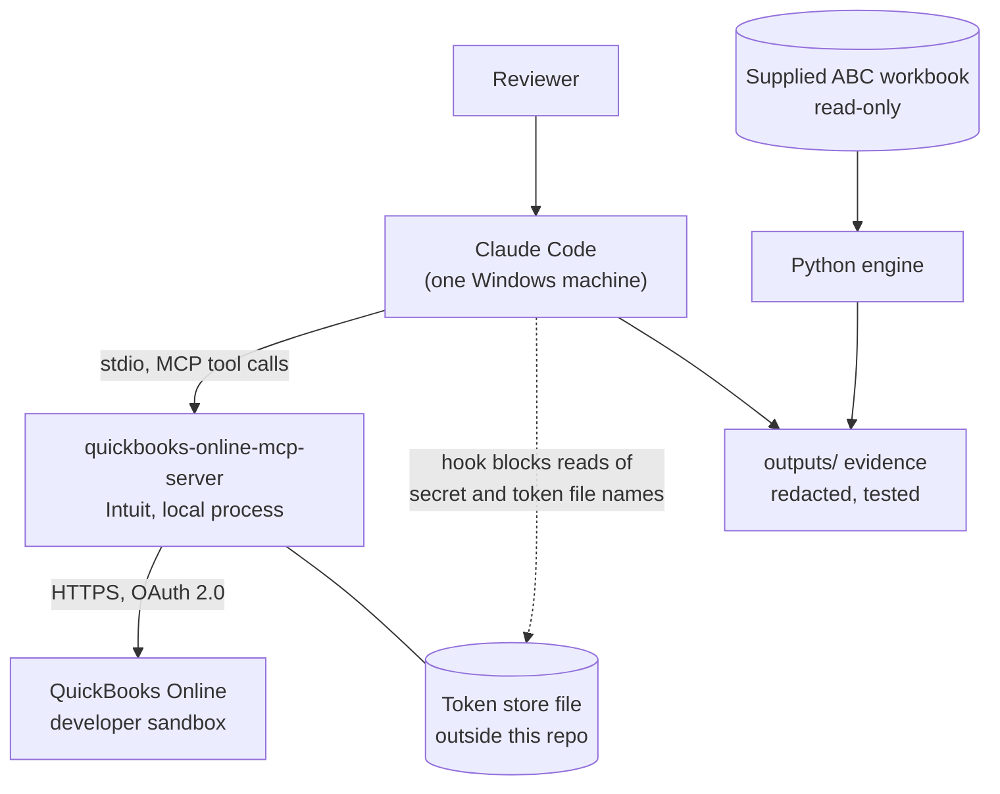
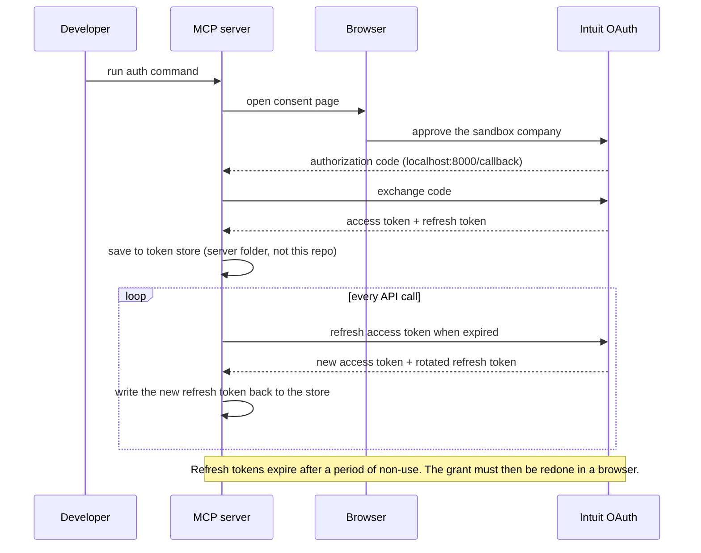
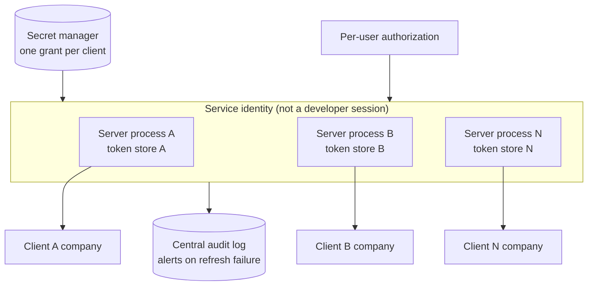

# Connection Architecture

How Claude Code reaches QuickBooks, how credentials are kept out of reach, and how read-only is enforced. Status key: **Implemented** is built and checked in this repo; **Proposed** is a design only.

## Component diagram (Implemented)

Claude Code only ever receives tool results. The tokens stay inside the server process and its token store. No network listener exists, so nothing is exposed to attack. The workbook feeds the analysis; QuickBooks does not.

## Credential lifecycle (Implemented)

Guards around the lifecycle: `CLAUDE.md` forbids reading secrets; a project hook blocks `Read`, `Grep` and `Bash` on secret, token and credential file names; saved evidence is redacted and a test checks it; the tracked-file secret scan found 0 findings in {{scan_files}} files.

## Read-only enforcement

The server registers a tool only if its category is not disabled. With `QUICKBOOKS_DISABLE_WRITE`, `QUICKBOOKS_DISABLE_UPDATE` and `QUICKBOOKS_DISABLE_DELETE` all set to `true`, create, update and delete tools **do not exist** for the client. That is stronger than telling the model not to call them.

| Layer | Control | Status |
|---|---|---|
| Server | Three disable flags set to `true`; write tools never registered | Implemented |
| Project rule | `CLAUDE.md` forbids flipping the flags or calling write tools | Implemented |
| Live check | 71 tools listed, none create, update or delete (2026-10-14) | Implemented |
| Credential | A separate write credential kept apart from the read-only one | **Not applied** |

Limit: this is not an authorization boundary. The OAuth grant itself carries accounting scope, so anyone who obtains the tokens could write directly to the API.

## Team hosting (Proposed)

Nothing here is built. The server speaks stdio only, so a shared service needs a wrapper that does not exist yet.

- One OAuth grant and one token store per client, mounted for exactly one server process, because two processes refreshing one rotating token can invalidate it.
- Verify each grant's realm ID against the expected company before first use.
- TLS on any network hop, a central audit log, alerts on refresh failures and approaching expiry, and a documented revoke-and-reauthorize runbook.
- Before production: fix the three runtime dependency findings in the dependency-risk note and decide who owns upgrades.

## Evidence summary (2026-10-14, read-only)

| Check | Result |
|---|---|
| (a) CompanyInfo read | PASS |
| (b) Monthly P&L Jan–Jun 2026 and Balance Sheet at 30 Jun 2026 | PASS; the balance sheet balances at 5,488.75 |
| (c) Tools registered | PASS; 71 tools, none create, update or delete |
| (d) Missing server folder | PASS; an actionable message and exit code 1 |
| Earlier failure (2026-10-13) | A script bug, not an expired token: the server's tools take `{"params": {...}}` and the script sent `{}`. Fixed; failures are now classified with a next step |

## Rejected options

| Option | Why not (for now) |
|---|---|
| Native Claude connector for QuickBooks | Availability for a sandbox company and its read-only controls were never established |
| Custom QuickBooks REST client or MCP | We would own OAuth refresh, pagination and rate limits; the official server already does this |
| Third-party hosted MCP gateway | Puts client data and tokens with another party and adds a vendor to vet |
| Manual CSV or report exports | Not repeatable, and does not meet the brief to test the MCP route |
| Enabling write tools | No requirement; posting entries is a different risk class |

These are judgements, not benchmarks; none was built or tried.
