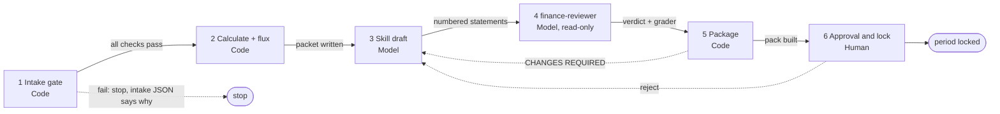
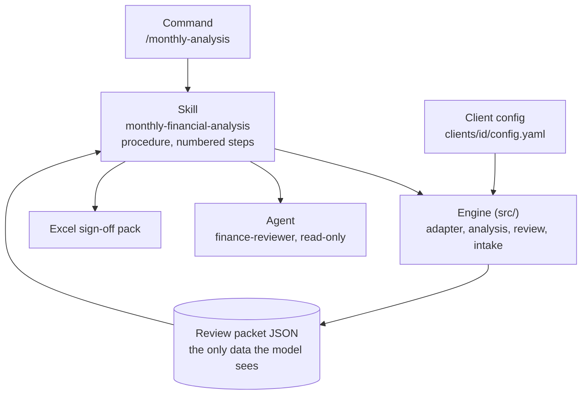
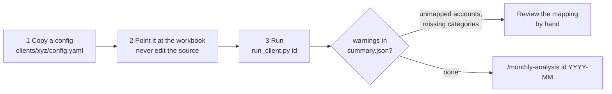

# Skill and Analysis Workflow

How a client's monthly workbook becomes a reviewed analysis, what the skill is made of, how a new client is added, and what the output looks like.

## End-to-end analysis flow

Six stages for one client and one month. Each stage has a gate: the next stage does not start until the gate passes. **Code** is deterministic Python, **Model** is Claude, **Human** is the reviewer.

| # | Stage | Gate |
|---|---|---|
| 1 | Intake gate | Workbook hash recorded; sheets, header, contiguous month columns and all total rows present; gross profit and operating income tie out; every section foots. Any failed check stops the run before any calculation |
| 2 | Calculate and flux | Runs in a client sandbox; months without enough history are "not available", never zero |
| 3 | Skill draft | Only numbers in the review packet; one numbered statement per line; no invented causes |
| 4 | finance-reviewer | Read-only agent returns `approve` or a numbered changes list |
| 5 | Package | APPROVED only if the reviewer said `approve` **and** the grader passed |
| 6 | Human approval | Reviewer name and reason required; approve refused unless the reviewer approved; an approved period is locked |

## Why numbers come from code and words from the model

A model asked to do arithmetic can be fluent and wrong. Here the model never sees the workbook, only the packet JSON for one client and month, and may state only numbers in it. Three independent checks then run on the text: the deterministic grader (every number, the 3 largest movements, cash and runway), the `finance-reviewer` agent (causes, direction words, unsupported claims), and a human.

## Skill anatomy

| Piece | Role |
|---|---|
| Skill (`SKILL.md`) | The procedure: audit, revenue trend, margins, operating expenses, MoM rules, TTM, cash and runway, anomaly flags, commentary |
| Engine (`src/`) | Parses the workbook, runs the intake gate, computes every figure, writes the packet and the Excel pack |
| Config | Per-client facts: workbook path, sheet and label names, month format, account-to-category map, fiscal-year start, thresholds |
| Agent | Read-only reviewer (Read, Grep, Glob only) that sees the packet and the commentary and nothing else |
| Command | `/monthly-analysis`: prepare, draft, review, revise once, build pack, report |

## Client-config model

A new client needs a config file, not code. The synthetic client `xyz` proves it: it differs from ABC in sheet name (`P&L`), header label (`Line Item`), month format (`%b-%y`, oldest first), section names, total names (`Net Profit`) and fiscal-year start (April). No engine code changed.

Limit: the parser expects a wide sheet with one column per month. A different layout needs code.

## Sample output walkthrough (ABC, June 2026)

Input: the ABC workbook. The pipeline runs the intake gate, then writes the review packet, the flux table and the analysis workbook. The commentary is numbered, one statement per line:

| # | Statement (abridged) |
|---|---|
| 1 | Revenue for 2026-06 was $195,898.16, a decrease of $12,452.80 (-5.98%) from 2026-05 |
| 2 | Gross profit was $137,425.72 at a gross margin of 70.15%, up 3.11 percentage points |
| 5–7 | The three largest movements: Events & Conferences up $17,970.67; Bad Debts down $14,741.53 (from $12,935.29 to a credit of -$1,806.24); Usage Fees down $11,142.74 |
| 8 | Trailing-twelve-month revenue was $2,303,975.51 |
| 9–10 | Cash was $713,481.26; runway 3.40 months on a 3-month average burn of $209,656.62 |

The flux table flags 5 items for June 2026 (thresholds: $5,000 and 10%, sign flips over $1,000); Bad Debts is a `SIGN_FLIP`. The Excel sign-off pack has six sheets: Summary, Commentary Sign-off, Numbers Check, Top Movements, Reviewer Changes and Open Questions. The sign-off column is left **blank** for the human.

The engine's own text, the reviewed text and the saved skill output all pass the grader; the flawed control fails it.
