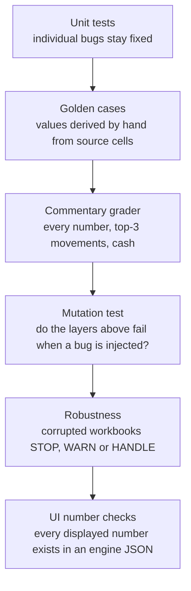
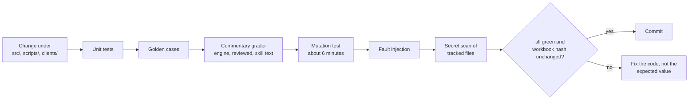

# Evals and Regression

How we show that the numbers and the commentary are right, and that the checks themselves can fail.

## Eval layers

| Layer | Command | What it proves | Latest |
|---|---|---|---|
| Unit tests | `python -m unittest discover -s tests` | Bugs stay fixed; client isolation; redaction; workflow failure messages | {{unit_result}} |
| Golden cases | `python 03_evals/run_golden_evals.py` | Engine numbers and flags equal values derived by hand | {{golden_result}} |
| Commentary grader | `python 03_evals/grade_commentary.py` | Every number matches the engine JSON; top-3 movements named; cash and runway covered | Engine, reviewed and saved-skill text PASS; flawed control FAILs as intended |
| Mutation test | `python 03_evals/mutation_test.py` | The tests fail when a known bug is injected | {{mut_result}} |
| Robustness | `python 03_evals/robustness/fault_injection.py` | Corrupted workbooks behave as declared on both entry points | {{fault_result}} |
| UI number checks | `python -m unittest tests.test_ui_numbers` | No displayed number is computed in the UI | 15 tests OK |

## Golden case table

{{golden}} cases in three groups. "Real workbook" means the ABC workbook read in memory, never modified.

| Source | Count | IDs | What the group is |
|---|---|---|---|
| `workbook` | {{g_wb}} | G01, G02, G03, G06 | Real data already triggers the rule; no cell changed |
| `workbook+perturbation` | {{g_pert}} | G04, G05, G07, G08, G14, G19–G22 | One or two cells changed to trigger a rule; G19–G22 require the intake gate to refuse a perturbed copy |
| ABC cell-sourced | {{g_cell}} | G09–G13, G15–G18 | Expected values computed by hand from cached source cells, not by the engine |

| Case | Pins |
|---|---|
| G01–G03, G06 | MoM revenue, gross margin, TTM needs twelve consecutive months, expense category trend |
| G04, G05, G07, G08, G14 | Duplicate month rejected; missing revenue rejected; zero prior revenue gives a null %; short TTM disclosed; month labels survive normalization |
| G09–G10 | February is the peak marketing month; the 5 one-off items, Dec 2025 the event month |
| G11–G13 | First valid TTM month is Dec 2025; largest OPEX spikes; full June 2026 summary |
| G15–G17 | Platform Revenue step-down in Jan 2026; Bad Debts reversal in Jun 2026; cash 713,481.26 and runway 3.40 months |
| G18 | Gross margin falls over 5 pp in Mar 2025, Aug 2025 and Apr 2026 only |
| G19–G22 | Intake STOP by family: structure, values, footing, coverage |

Tolerances: currency ±0.005; ratios, percentages and margins ±0.000001; identity fields exact. Below 100% fails.

## Mutation results

The runner refuses to start unless the unmodified copy is green. A mutant is an eval gap if nothing fails.

| Mutation | Files mutated | Caught |
|---|---|---|
| Reverse month order | `financial_analysis.py`, `abc_workbook_adapter.py` | yes, yes |
| Flip revenue sign | both | yes, yes |
| Sum subtotals twice | `abc_workbook_adapter.py` | yes |
| Shift months by one | both | yes, yes |
| Drop one opex category | both | yes, yes |
| TTM over 11 months | both | yes, yes |
| Wrong margin denominator | both | yes, yes |

**Total: {{mut_result}}** (7 bug classes). The wrong-denominator mutant is caught by G02, G13, G18 and two unit tests.

## Robustness matrix summary

Each fault is applied to a copy of the ABC workbook and run through both entry points that produce numbers (`run_pipeline.py` and step 1 of the skill). The required behaviour is fixed before the run. **STOP** means intake refuses with a message naming the cell or sheet and writes no packet. **WARN** means the run continues and the warning reaches the packet and the Data Quality sheet. **HANDLE** means no new warning and every number equals the baseline. **SILENT-WRONG** (success, different numbers, no warning) must never occur.

| Family | Faults | STOP | WARN | HANDLE | Examples |
|---|---|---|---|---|---|
| Structure | 11 | 6 | 1 | 4 | Prior month deleted; duplicated month; sheet renamed; merged headers |
| Values | 9 | 4 | 3 | 2 | Text in a numeric cell; Excel `#DIV/0!`; x1000 outlier; zero revenue; infinity |
| Labels | 7 | 2 | 3 | 2 | Renamed account; look-alike character; deleted section total |
| Coverage | 5 | 4 | 1 | 0 | Only 11 months; formulas without saved values; corrupt or locked file |
| **Total** | **32** | **16** | **8** | **8** | |

**Result: {{fault_result}}.** Full table with the message shown for each fault is in the Verification and Robustness Report.

## Regression procedure

A change is blocked by any of: a golden case that passed now fails; any unit test fails; a commentary number mismatch, a dropped top movement or lost cash coverage; a flag that changes behaviour; the source workbook's bytes changing; a caught mutant that now survives; a client-isolation failure; a new data-quality warning that no one reviewed; any fault that stops behaving as declared, or any SILENT-WRONG.

Expected values in the evals are never changed to make a test pass. If one looks wrong, the source-cell evidence (sheet, cell, value or formula) is shown and the owner decides. Wording changes that keep every number and movement are not regressions.
