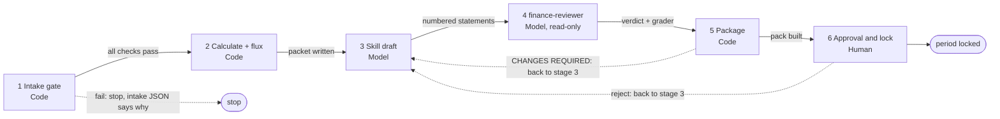

# Monthly close workflow

Six stages, one client and one month. Each stage has a gate: the next stage does not start, or its result is not accepted, until the gate passes. **Code** is deterministic Python; **Model** is Claude; **Human** is the reviewer. All files are written under `outputs/<client>/`.

| # | Stage | Who acts | Gate (what must be true) | Files produced |
|---|---|---|---|---|
| 1 | **Intake gate** | Code: `scripts/run_pipeline.py <client> <YYYY-MM>` (runs stages 1–2) | Workbook hash recorded. Income statement sheet and header row found, month columns contiguous, all six total rows present, amounts numeric, sections foot, gross profit = revenue − COGS and operating income = gross profit − opex for every month, the Balance Sheet balances every month and Current Year Earnings = year-to-date net income (each failure names its cell). Any failed check stops the run before any calculation. A period that is already approved is refused. | `intake_<month>.json` (workbook SHA-256, per-check result with cell reference), `tables_<month>.json` |
| 2 | **Calculate + flux** | Code: `src/monthly_review.py prepare`, then the flux table | Runs inside the client sandbox (no reads of other clients' files; writes only to its own output folder). Months without enough history return "not available", not zero. | `analysis.xlsx`, `summary.json`, `review_packet_<month>.json` (the only data the model sees), `flux_<month>.json`, `manifest_<run>-<client>-<month>.json` |
| 3 | **Skill draft** | Model: `/monthly-analysis` with the `monthly-financial-analysis` skill | Uses only numbers in the packet. One numbered statement per line. No invented causes. The deterministic grader (`03_evals/grade_commentary.py`) must later match every number to the packet. | `commentary_<month>.md` |
| 4 | **finance-reviewer** | Model: read-only subagent `.claude/agents/finance-reviewer.md`, given only the packet and the commentary | Returns `approve` or a numbered list of changes: wrong numbers or direction words, unsupported claims, missed movements, invented causes. It cannot edit the commentary. | `review_<month>.json` |
| 5 | **Package** | Code: `src/monthly_review.py build` | Verdict is APPROVED only if the reviewer said `approve` **and** the grader passed (every number matches, all top-3 movements named, cash risk covered when the client has cash data). Otherwise CHANGES REQUIRED. | `monthly_review_<month>.xlsx` (summary, commentary sign-off with empty sign-off column, numbers check, top movements, reviewer changes, open questions) |
| 6 | **Human approval / lock** | Human: `python scripts/approve.py <client> <month> --reviewer NAME --reason TEXT` (or the buttons in `05_review_workspace/`) | Reviewer name and reason are required. Approve is refused unless the finance-reviewer verdict is `approve`. Once approved the period is locked: no second decision, and the pipeline will not re-run it. Reject is always allowed. | `approval_<month>.json`, appended line in `audit_log.jsonl` |

## Notes

- Stages 1–2 are one command. Stages 3–5 run inside `/monthly-analysis`. Stage 6 is deliberately separate so a person, not a model, makes the final call.
- The pipeline also re-grades an existing commentary draft against a fresh packet and records a diff against the previous run in the manifest, so a re-run shows what moved.
- The source workbook is never written. QuickBooks is not part of this flow; the analysis reads the supplied workbook (see `01_connection/connection_decision.md`).
- Limits: the reviewer is an LLM and varies between runs; the deterministic checks do not judge causes or whether a movement is worth mentioning. `04_architecture/architecture.md` lists what breaks first.
