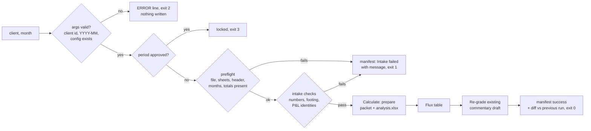

# (a) Intake → Calculate → Flux

`python scripts/run_pipeline.py <client> <YYYY-MM> [--clients-root DIR --outputs-root DIR]`. It runs the deterministic stages of a close, and the review workspace's **Run analysis** button runs the same command.

## Inputs
- `clients/<client>/config.yaml` and the workbook it names (read-only).
- The month to analyse, which must have its prior month in the data.

## Outputs (all under `outputs/<client>/`)
- `intake_<m>.json` and `tables_<m>.json`;
- `review_packet_<m>.json`, `analysis.xlsx`, `summary.json` and `commentary.md`;
- `flux_<m>.json`;
- `commentary_<m>.json`, only if a draft exists;
- `manifest_<run_id>.json`;
- one line appended to `audit_log.jsonl`.

## Gates
1. **Argument check, before any path is built.** The client id must match `^[a-z0-9][a-z0-9_-]{0,63}$`, the month must be `YYYY-MM`, and the client's config must exist.
2. **Lock.** `approval_<m>.json` with status `approved` stops the run.
3. **Intake gate** (`close_artifacts.intake_gate`, the same function `/monthly-analysis` uses):
   - *Preflight:* the file is readable, not locked and a real .xlsx. The required sheets are present. Formula cells have cached values, and no cell holds an Excel error value. The header row, unmerged month headers, no duplicate months, the requested month and its prior month, and every total and section-total row must all be present.
   - *Checks:* every amount is a number; month columns are contiguous; gross profit and operating income tie out in every month; each section's lines foot to its total in every month.
4. **Client sandbox.** Reads are limited to the client's own folders and writes to `outputs/<client>/`.

## Failure modes and what the user sees (from runs on 2026-10-14)

| Failure | Exit | Message (abridged) |
|---|---|---|
| Client id like `../x` | 2 | `ERROR: invalid client id '../x'; use lowercase letters, digits, '-' or '_' (e.g. abc).` Before the fix this crashed with a traceback while trying to write `outputs/../x/`. |
| Unknown client | 2 | `ERROR: unknown client 'nope': no clients\nope\config.yaml. Add a config (see 02_skill/README.md).` |
| Bad month `2026-13` | 2 | `ERROR: month must look like 2026-06, got '2026-13'.` Before: a raw `DateParseError` |
| Month not in the data | 1 | `Intake: failed - Intake refused the workbook: Income Statement: no column for 2024-01 (the requested month) …` |
| Workbook problem (32 kinds) | 1 | The intake message names the cell or sheet, e.g. `Total Income foots to its lines (every month) at Income Statement!F14 (2026-03: lines - total = 1,000.00)`. See `03_evals/robustness/ROBUSTNESS_REPORT.md` |
| Period approved | 3 | `abc 2026-06 is approved and locked; not re-running.` |

## Idempotency
- A re-run with the same workbook rewrites the same files with the same numbers.
- Each run adds a new manifest whose `diff_vs_previous.changed` is empty if nothing changed, plus one audit line.
- A failed run writes a manifest and an audit line, but no packet.

## Tested in
- `tests/test_workflow_failures.py`: `Pipeline.*` covers traversal, bad month, unknown client and the sandbox id check.
- `tests/test_robustness.py`: the intake gate.
- `03_evals/robustness/fault_injection.py`: 32 faults.
- `tests/test_client_isolation.py`.
- `tests/test_ui_numbers.py`, which reads pipeline outputs.
- Golden G19–G22.
