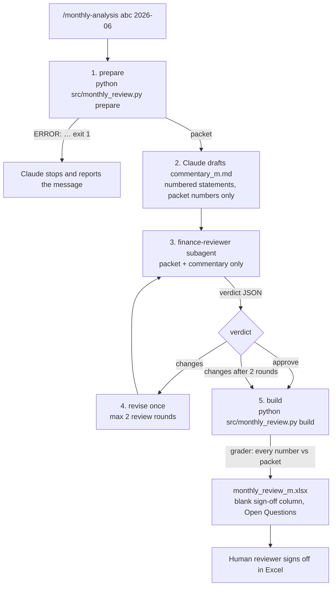

# (b) `/monthly-analysis`: draft → finance-reviewer → grade → pack

A Claude Code command (`.claude/commands/monthly-analysis.md`). Code computes every number; Claude writes and reviews the text; a person signs off.

## Inputs
- Client and month.
- The workbook, through the client config.
- The `monthly-financial-analysis` skill guidance.
- The finance-reviewer agent (`.claude/agents/`), which is read-only.

## Outputs (`outputs/<client>/`)
- From `prepare`: `analysis.xlsx` and `review_packet_<m>.json`.
- From Claude: `commentary_<m>.md`.
- From the reviewer: `review_<m>.json`.
- From `build`: `monthly_review_<m>.xlsx`.

## Gates
1. **`prepare` runs the same intake gate as the pipeline**, before anything is written. Until Phase 2 this path skipped intake, and 8 of 32 corrupted workbooks produced wrong numbers silently.
2. The commentary must be numbered `1.`, `2.`, … in order (`parse_statements`).
3. Every number in each statement is graded against the packet (`grade_commentary.grade`). A mismatch, a reviewer "changes" verdict, or missing cash coverage blocks approval in the pack.
4. Sign-off cells are always blank; nothing is signed for anyone.

## Failure modes and what the user sees (from runs on 2026-10-14)

| Failure | Exit | Message |
|---|---|---|
| Workbook refused by intake | 1 | `ERROR: Intake refused the workbook: …` or `ERROR: Intake checks failed …`, naming the cell. Before Phase 3 this was a full Python traceback. |
| Unknown client or bad month | 1 | `ERROR: Unknown client 'nope': …config.yaml not found. Add a client config (see 02_skill/README.md).` and `ERROR: Month must look like 2026-06, got '2026-13'` |
| `build` without a packet, commentary or verdict, or with an invalid verdict JSON | 1 | `ERROR: Review packet not found: … Run 'python src/monthly_review.py prepare abc 2026-06' first.` and `ERROR: Reviewer verdict is not valid JSON: … (line 1)` |
| Commentary not numbered | 1 | `ERROR: Commentary must contain statements numbered 1., 2., 3. ... in order, one per line.` |
| Claude invents or miscopies a number | 0 | The pack's number-check column shows `MISMATCH: …` and approval is blocked (`test_wrong_number_blocks_approval_even_if_reviewer_approves`). |

## Idempotency
- `prepare` is deterministic: the same packet every time.
- Drafting is not deterministic, because the model writes the text. The grader judges each draft against the packet, never against an earlier draft.
- `build` always writes `monthly_review_<m>.xlsx`; a second build overwrites the first. Keep a control copy under another name, as `_flawed_control.xlsx` is kept.

## Tested in
- `tests/test_workflow_failures.py`: `SkillSteps.*`.
- `tests/test_monthly_review.py`: numbering, mismatch blocks approval, reviewer changes block approval, missing cash blocks approval.
- `tests/test_robustness.py`: `SkillPathUsesTheGate`.
- `03_evals/grade_commentary.py`, with a flawed control that must FAIL.
- `fault_injection.py`, which runs every fault through `prepare`.
- Not tested: a live `/monthly-analysis` run in Claude. The saved skill output is graded as it is on disk.
