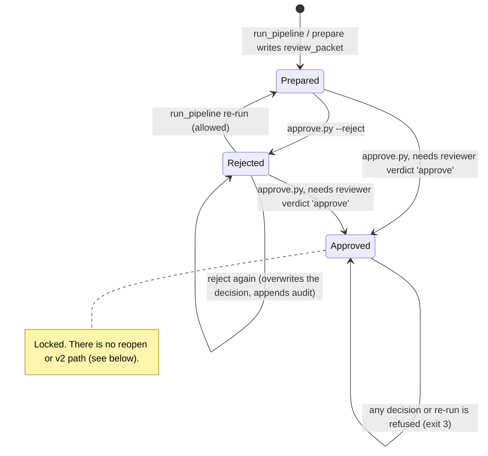

# (c) Approve / reject / lock / re-run

`python scripts/approve.py <client> <YYYY-MM> --reviewer NAME --reason TEXT [--reject]`. The workspace's Approve and Reject buttons run the same command.

## Inputs
- `outputs/<client>/review_packet_<m>.json`, which is required.
- `review_<m>.json` (the finance-reviewer verdict), which approval requires.
- A reviewer name and a reason, both non-empty.

## Outputs
- `approval_<m>.json`, recording the status, reviewer, reason, time, verdict and the packet's SHA-256.
- One `period_approved` or `period_rejected` line appended to `audit_log.jsonl`.

## Gates
1. Client id and period format are checked.
2. The reviewer name and reason must be non-empty.
3. The packet must exist.
4. An already-approved period is locked.
5. Approving needs the reviewer's verdict to be `approve`.
6. A decision or verdict file that can't be read refuses the request and records nothing. It never guesses.

## Failure modes and what the user sees (from runs and tests, 2026-10-14)

| Failure | Exit | Message |
|---|---|---|
| Approved period | 3 | `ERROR: abc 2026-06 is approved and locked`. The pipeline also refuses: `… is approved and locked; not re-running.` |
| No packet | 1 | `ERROR: no review packet for zz 2026-06; run the pipeline first` |
| Reviewer verdict is not `approve` | 4 | `ERROR: cannot approve: finance-reviewer verdict is 'changes', not 'approve'` |
| Missing name or reason; bad period | 2 | `ERROR: reviewer name and reason must not be empty` and `ERROR: invalid client or period` |
| Damaged `approval_<m>.json` or `review_<m>.json` | 5 | `ERROR: cannot read an existing decision or verdict file as JSON (JSONDecodeError); check … Nothing was recorded.` Before Phase 3: a traceback |

## Idempotency
- Repeating a reject overwrites `approval_<m>.json`, and each attempt adds an audit line, so history is kept in the log, not in the file.
- Approval is final.
- The packet hash in the approval record shows which numbers were approved.

## Re-run as v2: not implemented
The brief workflow asks for "re-run as v2" after approval. Today an approved period can't be re-run, reopened or versioned. The pipeline exits 3, and `approve.py` refuses. Deleting `approval_<m>.json` by hand would bypass the lock, and the audit log would still show the approval.

A v2 path needs a controls decision first:
- who may reopen an approved period;
- whether v1's packet and pack are archived (for example `*_v1.*`) before v2 is written;
- how the reopen is recorded in the audit log.

That decision is the owner's, so it was not built.

## Tested in
- `tests/test_workflow_failures.py`: `Approval.*` covers the damaged file (exit 5, no audit line) and the lock (exit 3).
- `tests/test_ui_numbers.py`: `test_approved_period_renders_as_locked`.
- `tests/test_monthly_review.py`: the reviewer verdict blocks approval.
