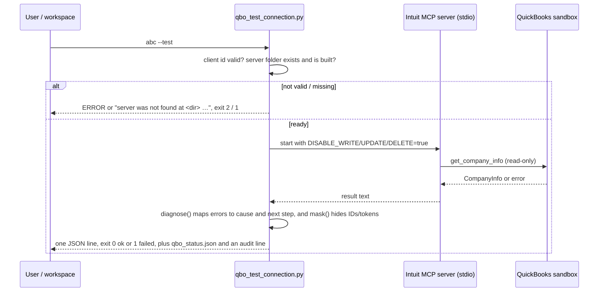

# (d) QuickBooks connection test and evidence capture

- `python 01_connection/qbo_test_connection.py <client> [--test]` refreshes the status and, with `--test`, makes one read-only CompanyInfo call. The workspace's **Test connection** button runs it.
- `python 01_connection/evidence/quickbooks/capture_dated.py` saves today's redacted, read-only checks.

## Inputs
- The server checkout: `quickbooks-online-mcp-server/` beside the repo, or the folder named by `QBO_MCP_SERVER_DIR`.
- The server's own environment file, which this repo never reads.
- Node.js on PATH.

## Outputs
- `qbo_test_connection.py` writes `outputs/<client>/qbo_status.json` (flags, last test, last evidence date) and appends an audit line.
- `capture_dated.py` writes `01_connection/evidence/quickbooks/<YYYY-MM-DD>/` (redacted requests and responses, `summary.json`).

## Gates
1. The client id is validated.
2. The server must exist and be built.
3. The write, update and delete disable flags are forced to `true` on every start. The server then doesn't register any create, update or delete tool (`src/helpers/register-tool.ts`), and the 2026-10-14 capture recorded 71 tools with none of them a write tool.
4. Server text is stored only after `mask()` (IDs and tokens removed) or `redact()`.
5. The capture exits 1 if a secret-like pattern survives redaction.

## Failure modes and what the user sees

| Failure | Exit | Message |
|---|---|---|
| Server not cloned or built | 1 | `The QuickBooks MCP server was not found at '<dir>'. It is not part of this repo: clone Intuit's quickbooks-online-mcp-server there (or set QBO_MCP_SERVER_DIR …), then run 'npm install', 'npm run build' and 'npm run auth' in it.` Before Phase 1 this exited 0. |
| Expired or revoked token; wrong keys; wrong environment | 1 | A fixed next step per cause, e.g. `The refresh token is expired or revoked. In quickbooks-online-mcp-server run 'npm run auth' …`. Seven causes, in `DIAGNOSES` |
| Network or outage | 1 | `The server could not reach quickbooks.api.intuit.com. Check internet access, VPN or proxy, then retest.` or `No response within 45 seconds …` |
| Invalid client id | 2 | `ERROR: invalid client id 'ABC'; use lowercase letters, digits, '-' or '_' (e.g. abc).` Before Phase 3 this exited 2 with no output. |
| Node.js missing | 1 | `Node.js was not found. Install Node.js and make sure 'node' is on PATH.` |

## Idempotency
- Each `--test` overwrites `qbo_status.json` and adds one audit line; a failed test is recorded as `failed`.
- A capture overwrites that day's folder.
- Nothing is written to QuickBooks: no write tool exists in the session.

## Tested in
- `tests/test_workflow_failures.py`: `Connection.*` covers the invalid client, and the missing server (exit 1, status written to a temp root).
- `tests/test_qbo_diagnose.py`: every cause has a next step; stored text hides IDs.
- `tests/test_evidence_redaction.py`.
- Live: `01_connection/evidence/quickbooks/2026-10-14/README.md` (checks a–d).
