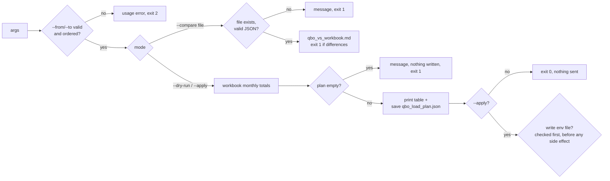

# (e) Sandbox loader `--dry-run`, and `--compare`

`python 01_connection/load_workbook_to_sandbox.py [--dry-run | --apply | --compare PNL_JSON] [--from YYYY-MM] [--to YYYY-MM]`. The default is `--dry-run`. `--apply` has never been run against the sandbox (stretch goal not done).

## Inputs
- The ABC workbook, through `clients/abc/config.yaml`.
- An optional month range.
- For `--compare`: a saved QBO monthly P&L, such as the one `capture_dated.py` writes.
- For `--apply`: a write-scoped env file outside the repo (`.secrets/`). The repo never reads or prints it.

## Outputs
- `outputs/abc/qbo_load_plan.json`, which is the plan for exactly the selected range.
- `outputs/abc/qbo_vs_workbook.md`, from `--compare`.

## Gates
- Month arguments are validated.
- An empty plan is never saved.
- `--apply` without its env file stops before any file or network side effect.
- Every journal entry must balance (debits = credits) before it is planned.

## Failure modes and what the user sees (from runs on 2026-10-14)

| Failure | Exit | Message |
|---|---|---|
| Bad `--from`/`--to` | 2 | `error: --from must look like 2026-06, got '2026-13'` and `error: --from 2026-06 is after --to 2026-01`. Before Phase 3: a `DateParseError` traceback |
| Range with no workbook months | 1 | `No workbook months between 2027-01 and the end (workbook: 2025-01 to 2026-06); nothing was written.` Before Phase 3 this exited 0 and **overwrote the saved plan with an empty one**. |
| `--compare` file missing or not JSON | 1 | `--compare file not found: … Save a QBO monthly P&L first (…capture_dated.py).` and `--compare file is not valid JSON: …`. Before Phase 3: tracebacks |
| `--apply` without the env file | 1 | `--apply needs the write-scoped env file: … (not found; nothing was changed)` |
| `--compare` finds no loaded accounts (today's sandbox) | 1 | A table row per metric: `account 'Workbook Load - Total Income' not in the QBO P&L` |

## Idempotency
- A dry run is deterministic. A dry run with a range replaces the saved plan with that range's plan, which is what `--apply` would create.
- `--apply` skips entries that already exist with the same amounts, and reports a different existing entry as a CONFLICT, leaving it alone (tested with an in-memory fake, never live).

## Tested in
- `tests/test_workflow_failures.py`: `Loader.*` covers bad dates, reversed range, bad compare file, and an empty range writing nothing.
- `tests/test_qbo_load.py`: dry run creates nothing; apply is idempotent; conflict left alone; apply without env file stops before network and writes nothing.
