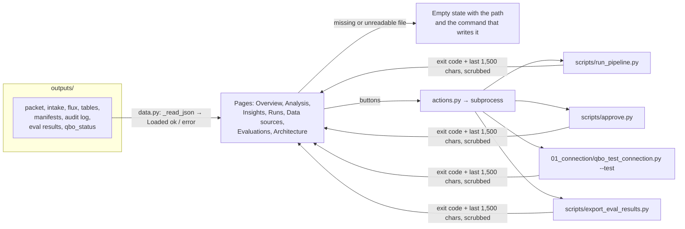

# (f) Review workspace UI (display only)

`streamlit run 05_review_workspace/app/Home.py`. The UI only reads JSON and Excel that the engine wrote under `outputs/`, and it never calculates a figure (`CLAUDE.md`, "UI rule"). Its buttons run the same scripts as the command line.

## Inputs
- JSON and Excel in `outputs/` (see workflows a–d).
- The client and period chosen in the sidebar.

## Outputs
- None of its own. Buttons cause the scripts above to write their usual outputs.

## Gates
1. **No calculation modules:** pages may not import the engine, pandas maths helpers, etc. (an AST check, plus a clean-interpreter import check).
2. **Numbers come from the engine:** every amount and percentage displayed must exist in the engine JSON.
3. **Secrets are withheld:** credential-like fields in a JSON file are not shown, and script output is passed through `ui.scrub` before display.
4. **Locked periods:** an approved period disables Run analysis (`runs.py`) and hides the decision form (`insights.py`).

## Failure modes and what the user sees

| Failure | What is shown |
|---|---|
| No clients, or a client with no engine files | An empty state naming the missing file and the command that writes it (`Reviewer Excel not available yet: outputs/<client>/monthly_review_<period>.xlsx`) |
| Unreadable or corrupt JSON | An empty state with the file path; never a traceback (`test_unreadable_json_shows_an_empty_state_not_a_traceback`) |
| A button's script fails | `Pipeline failed.`, `Golden evals did not complete.`, or the script's own `ERROR:` line, scrubbed. Since Phases 1 and 3, the scripts exit non-zero on failure, so the UI no longer shows a failed connection test as success. |
| A button's script hangs | `scripts/run_pipeline.py did not finish within 180 seconds and was stopped. Run it from a terminal to see its progress.` Before Phase 3: "Could not start script: TimeoutExpired" |
| Python or Node missing | `Could not start <script>: FileNotFoundError` and, on Data sources, `The test script could not run. Check that Python and Node.js are installed …` |

## Idempotency
- Pages are read-only and render the same files the same way.
- Buttons are as idempotent as the scripts they run (see a, c, d).

## Tested in
`tests/test_ui_numbers.py` (15 tests):
- every page renders without exceptions;
- displayed numbers exist in the engine JSON;
- no secrets are shown;
- empty states;
- unreadable JSON;
- credentials withheld;
- approved period locked.

`tests/test_workflow_failures.py`: `WorkspaceActions` (timeout message).

Not tested: the buttons are not clicked against a running Streamlit server, and the browser rendering is not checked.
