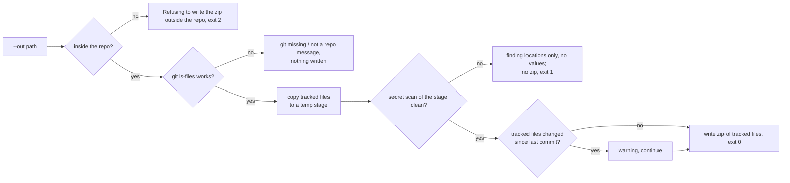

# (g) Package the submission

`python scripts/package_submission.py [--out dist/submission.zip]`

## Inputs
- The git-tracked files only. Ignored files (environment files, tokens, `node_modules`, the untracked MCP server clone) can't get in.

## Outputs
- `dist/submission.zip`, or the `--out` path inside the repo.

## Gates
1. The output path must be inside the repo.
2. git must be available.
3. The secret scan runs on a staged copy of exactly the files that ship. Any finding stops the build, and the scan prints file:line and pattern name, never the value.
4. A dirty working tree gives a warning.

## Failure modes and what the user sees

| Failure | Exit | Message |
|---|---|---|
| Secret-like value in a tracked file | 1 | `Secret-like findings: N` with file:line and kind, then `Secret scan is not clean; no zip was built.` |
| `--out` outside the repo | 2 | `Refusing to write the zip outside the repo.` |
| git missing or not a repository | 1 | `Cannot list tracked files: git is not installed or this folder is not a git repository. … nothing was written.` Before Phase 3: a `CalledProcessError` or `FileNotFoundError` traceback |
| Uncommitted changes | 0 | `Warning: tracked files have uncommitted changes; the zip holds the working-tree versions.` |

## Idempotency
- The previous zip is deleted and rebuilt from the same tracked-file list.
- Contents equal the working tree at the time of the run.

## Tested in
- `tests/test_workflow_failures.py`: `Packaging.*` covers no git (no zip written) and a zip outside the repo.
- `tests/test_scan_secrets.py`: planted values found, values never printed, file paths scanned, missing path fails.
- `tests/test_hooks.py`: secret files blocked from tool reads.
