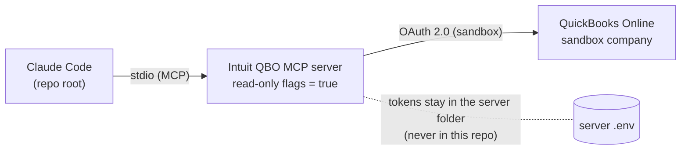
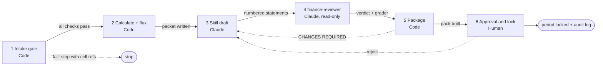

# AI Solutions Builder: Build Exercise Submission

**Submission for the RE Financial Services "Build Exercise — AI Solutions Builder".**

This repository connects Claude to a QuickBooks Online sandbox through a read-only MCP server. It turns an 18-month financial workbook into a reviewed monthly trend analysis through a Claude skill, and it proves the result with a layered evaluation suite. The design rule throughout: **Python computes every number, Claude writes and reviews the words, and a human makes the final call.**

Everything except the live QuickBooks connection runs offline on the supplied workbook. **You don't need a QuickBooks account, an API key or Claude to verify the core results.**

---

## Contents

1. [At a glance](#1-at-a-glance)
2. [Where each deliverable lives](#2-where-each-deliverable-lives)
3. [Latest results](#3-latest-results)
4. [Tech stack](#4-tech-stack)
5. [Quickstart (5 minutes, no credentials)](#5-quickstart-5-minutes-no-credentials)
6. [Full setup walkthrough](#6-full-setup-walkthrough)
7. [Part 1: QuickBooks sandbox connection](#7-part-1-quickbooks-sandbox-connection)
8. [Part 2: The monthly trend-analysis skill](#8-part-2-the-monthly-trend-analysis-skill)
9. [Part 3: Evaluation suite](#9-part-3-evaluation-suite)
10. [Part 4: Architecture](#10-part-4-architecture)
11. [The month-end close workflow](#11-the-month-end-close-workflow)
12. [Credential and data handling](#12-credential-and-data-handling)
13. [What the analysis found in the ABC workbook](#13-what-the-analysis-found-in-the-abc-workbook)
14. [What the evals caught while building](#14-what-the-evals-caught-while-building)
15. [Common tasks](#15-common-tasks)
16. [Troubleshooting](#16-troubleshooting)
17. [What's not done, and known limits](#17-whats-not-done-and-known-limits)
18. [Repository map](#18-repository-map)

---

## 1. At a glance

| | |
|---|---|
| **Connection** | Intuit's official QuickBooks Online MCP server over stdio, with write, update and delete tools disabled at registration |
| **Skill** | `monthly-financial-analysis`: revenue, margins, opex by category, MoM, TTM, cash and runway, flagged movements, numbered commentary |
| **Review** | A read-only `finance-reviewer` subagent plus a deterministic commentary grader, then a human sign-off that locks the period |
| **Evals** | Unit tests, 22 golden cases, a commentary grader, 13 mutation tests, a 32-fault robustness suite, UI number checks |
| **Multi-client** | Each client is a `config.yaml`; a synthetic second client (`xyz`) runs with no code changes |
| **Safety** | Read-only workbook (hash-checked), hooks that block secret files, a secret scan before packaging, per-client sandboxing |

---

## 2. Where each deliverable lives

The brief asks for four deliverables. Each has its own folder.

| Brief part | Deliverable | Folder | Start with |
|---|---|---|---|
| **1** | Working connection: config, server, code, plus the decision write-up | [`01_connection/`](01_connection/) | [`connection_decision.md`](01_connection/connection_decision.md) |
| **2** | The skill file(s) | [`02_skill/`](02_skill/) → [`.claude/skills/`](.claude/skills/) | [`SKILL.md`](.claude/skills/monthly-financial-analysis/SKILL.md), [`02_skill/README.md`](02_skill/README.md) |
| **3** | Eval cases and the grading approach | [`03_evals/`](03_evals/) | [`GRADING.md`](03_evals/GRADING.md), [`golden_cases.json`](03_evals/golden_cases.json) |
| **4** | One-page architecture note | [`04_architecture/`](04_architecture/) | [`architecture.md`](04_architecture/architecture.md) |
| — | Requirement-by-requirement status | [`04_architecture/`](04_architecture/) | [`brief_traceability.md`](04_architecture/brief_traceability.md), [`verification_matrix.md`](04_architecture/verification_matrix.md) |
| — | PDF pack (overview, architecture, workflows) | [`00_START_HERE/`](00_START_HERE/) | [`00_START_HERE/README.md`](00_START_HERE/README.md) |
| Extra | Optional review UI (display only) | [`05_review_workspace/`](05_review_workspace/) | [`05_review_workspace/README.md`](05_review_workspace/README.md) |

> **Why the skill lives in `.claude/skills/`:** that's where Claude Code discovers project skills, agents, slash commands and hooks. `02_skill/` explains it and holds sample outputs, so a reviewer doesn't need to open hidden folders first.

---

## 3. Latest results

From the clean-state runs on **2026-10-14**. Full records: [`03_evals/FINAL_RUN.md`](03_evals/FINAL_RUN.md) and [`04_architecture/verification_matrix.md`](04_architecture/verification_matrix.md).

| Check | Command | Result |
|---|---|---|
| Unit tests (incl. UI number checks and robustness regressions) | `python -m unittest discover -s tests` | **129 / 129 pass** |
| Golden cases | `python 03_evals/run_golden_evals.py` | **22 / 22 pass** |
| Mutation test | `python 03_evals/mutation_test.py` | **13 / 13 mutants caught**, 0 survived |
| Commentary grader | `python 03_evals/grade_commentary.py` | **PASS** on engine text, reviewed text and saved skill output; **FAIL** on the deliberately flawed control, as intended |
| Fault injection (broken workbooks) | `python 03_evals/robustness/fault_injection.py` | **32 / 32 faults handled correctly** on both entry points |
| Client runs | `python src/run_client.py abc` / `xyz` | Both succeed; `xyz` reports 1 expected warning |
| Live QuickBooks (read-only) | `python 01_connection/qbo_test_connection.py abc --test` | **Pass**: CompanyInfo, monthly P&L Jan–Jun 2026, Balance Sheet at 30 Jun 2026; no write tool registered |
| Secret scan (tracked files) | `python scripts/scan_secrets.py <paths>` | **0 findings** |
| Source workbook integrity | SHA-256 before and after every run | **Unchanged** (`75da8d679a89551f…`) |

**What these prove:** the numbers are right on the supplied workbook, the checks can fail when something is wrong, broken input never yields a silent wrong answer, and the connection worked on the date shown.
**What they don't prove:** that the commentary is insightful. Usefulness is judged by the reviewer subagent and a human, not by code.

---

## 4. Tech stack

| Layer | Technology | Used for |
|---|---|---|
| AI | **Claude Code** (Claude Pro) | Skills, the `finance-reviewer` subagent, the `/monthly-analysis` slash command, safety hooks, headless runs (`claude -p`) |
| Integration | **Model Context Protocol (MCP)** over stdio | The link between Claude and QuickBooks |
| QuickBooks | **Intuit's official `quickbooks-online-mcp-server`** (Node.js / TypeScript), **QuickBooks Online sandbox**, **OAuth 2.0** | Read-only access to sandbox accounting data |
| Engine | **Python 3.11+** (built and tested on 3.13.5) | All calculations, the intake gate, the pipeline |
| Data | **pandas**, **NumPy**, **openpyxl** | Parsing the workbook, metrics, writing the Excel review pack |
| Config | **PyYAML** | Per-client `config.yaml` files |
| Tests | **unittest** (stdlib), custom golden, mutation and fault-injection runners | The eval suite |
| UI (optional) | **Streamlit** (+ Graphviz chart) | The display-only review workspace |
| Docs | Markdown + **Mermaid** diagrams; PDFs rendered from Markdown | Architecture and workflow documentation |
| Tooling | **git** (tags per milestone), **Node.js + npm** (MCP server only), Windows 11 / PowerShell | Version control, packaging |

**Python dependencies:** see [`requirements.txt`](requirements.txt).
**Node dependencies:** only inside the separately cloned MCP server, not in this repo.

---

## 5. Quickstart (5 minutes, no credentials)

Requirements: **Python 3.11 or newer** and `pip`. Run from the repo root.

```powershell
# 1. Install dependencies
pip install -r requirements.txt

# 2. Run the unit tests (~1 min). Expect: OK
python -m unittest discover -s tests

# 3. Run the golden cases. Expect: Score: 22/22
python 03_evals/run_golden_evals.py

# 4. Run the close pipeline for ABC, June 2026 (intake gate + calculate + flux)
python scripts/run_pipeline.py abc 2026-06

# 5. Grade the engine's commentary. Expect: PASS
python 03_evals/grade_commentary.py
```

Then open **[`02_skill/sample_outputs/`](02_skill/sample_outputs/)** to see what a reviewer receives: the Excel review pack, the commentary and the flux table.

**Optional, slower checks:**

```powershell
python 03_evals/mutation_test.py                  # ~6 min. Expect: 13/13 mutants caught
python 03_evals/robustness/fault_injection.py     # ~2 min. Expect: 32/32 faults handled
python src/run_client.py xyz                      # a second, different company from config only
streamlit run 05_review_workspace/app/Home.py     # optional UI; reads outputs/ only
```

On macOS/Linux use `python3` and the same paths. Everything is plain Python; nothing is Windows-specific except the file-lock fault test.

---

## 6. Full setup walkthrough

### 6.1 Prerequisites

| Need | For | Required? |
|---|---|---|
| Python 3.11+ | Engine, evals, pipeline | **Yes** |
| git | Cloning, history, packaging | Yes |
| Claude Code (signed in on a Claude plan) | Running the skill, subagent and slash command | For Part 2 live runs |
| Node.js 18+ and npm | Building the QuickBooks MCP server | For Part 1 live runs |
| An Intuit developer account (free) | The QuickBooks sandbox | For Part 1 live runs |

### 6.2 Get the code and install

```powershell
git clone <this-repo> RE
cd RE
pip install -r requirements.txt
python -m unittest discover -s tests
```

### 6.3 Set up the QuickBooks sandbox (Part 1, live)

1. **Create an Intuit developer account** at [developer.intuit.com](https://developer.intuit.com). A sandbox company is created for you automatically.
2. **Create an app** in the developer portal with the QuickBooks Online Accounting scope. Copy the **development** Client ID and Client Secret, (Keys & Credentials page), and under Settings → Redirect URIs add `http://localhost:8000/callback`, exactly as the MCP server's README says.
3. **Clone Intuit's MCP server into the repo root** (it's git-ignored, so it is never committed or zipped):
   ```powershell
   git clone https://github.com/intuit/quickbooks-online-mcp-server.git
   cd quickbooks-online-mcp-server
   npm install
   npm run build
   ```
4. **Configure the server's credentials** in its own `.env`, following its `.env.example`. Set the environment to **sandbox**. That file stays inside the server folder: never copy it into this repo, and never paste its values into Claude.
5. **Authorise** by running `npm run auth` and signing in to your sandbox company in the browser that opens. The refresh token and realm ID are written to the server's own env file and stay in the server folder.
6. **Register the server with Claude Code, read-only.** Use [`01_connection/.mcp.json.example`](01_connection/.mcp.json.example) as the template. It sets:
   ```
   QUICKBOOKS_DISABLE_WRITE=true
   QUICKBOOKS_DISABLE_UPDATE=true
   QUICKBOOKS_DISABLE_DELETE=true
   ```
   With these flags on, the server never registers create, update or delete tools ([evidence](01_connection/evidence/quickbooks/2026-10-14/)).
7. **Verify:**
   ```powershell
   cd ..
   claude mcp list                                        # 'quickbooks' should be listed as connected
   python 01_connection/qbo_test_connection.py abc --test # expect ok: true (CompanyInfo)
   ```
   If the server folder lives elsewhere, set `QBO_MCP_SERVER_DIR` to its path. A failed test exits with code 1 and an actionable message (see [Troubleshooting](#16-troubleshooting)).

### 6.4 Run the skill in Claude Code (Part 2, live)

Start Claude Code **from the repo root**, so it loads the project's skills, agent, command and hooks:

```text
/monthly-analysis abc 2026-06
```

This prepares the data packet, drafts numbered commentary, sends it to the `finance-reviewer` subagent, grades it, and writes the Excel review pack to `outputs/abc/`.

### 6.5 Approve or reject (human sign-off)

```powershell
python scripts/approve.py abc 2026-06 --reviewer "Your Name" --reason "Reviewed flux and commentary"
python scripts/approve.py abc 2026-06 --reviewer "Your Name" --reason "Bad Debts needs support" --reject
```

Approval is refused unless the reviewer verdict is `approve`. Once approved, the period is **locked**: the pipeline won't re-run it, and every decision is appended to `outputs/abc/audit_log.jsonl`.

---

## 7. Part 1: QuickBooks sandbox connection

**Folder:** [`01_connection/`](01_connection/)

### 7.1 What was chosen, and why

**Intuit's official QuickBooks Online MCP server, run locally over stdio, with all write tools disabled.**

| Option | Verdict | Reason |
|---|---|---|
| **Official Intuit MCP server (chosen)** | ✅ | Maintained by the API owner, covers the reports and entities needed, works natively with Claude Code, and its disable flags allow a verifiable read-only mode |
| Native Claude connector | ❌ Rejected | Less control over scoping and over where credentials live; read-only enforcement isn't demonstrable in the same way |
| Custom MCP on the QuickBooks API | ❌ Rejected | Rebuilds OAuth, token refresh and report parsing that already exist and are maintained, adding risk with no benefit for this scope |

Full reasoning: [`connection_decision.md`](01_connection/connection_decision.md). Supply-chain notes (npm audit triage): [`dependency_risk.md`](01_connection/dependency_risk.md).

### 7.2 How it works



### 7.3 Proof it works

| Evidence | Where |
|---|---|
| 8 redacted request/response pairs (P&L, GL, Balance Sheet, CompanyInfo), 2026-10-12 | [`evidence/quickbooks/`](01_connection/evidence/quickbooks/) |
| Dated re-check on 2026-10-14: CompanyInfo, monthly P&L, Balance Sheet, tool list | [`evidence/quickbooks/2026-10-14/`](01_connection/evidence/quickbooks/2026-10-14/) |
| Read-only enforcement: 71 tools registered, none of them create/update/delete; the server source lines that skip write tools when the flags are true | [`2026-10-14/README.md`](01_connection/evidence/quickbooks/2026-10-14/README.md) |
| Redaction is tested | `tests/test_evidence_redaction.py` |

### 7.4 Team hosting (proposed, not built)

For a whole team, the server would run as a shared service instead of on one laptop: a remote MCP transport behind the firm's SSO, a **separate OAuth grant per client company**, tokens in a secrets manager, per-user audit logs, and read-only flags enforced centrally. This is a design; the server's stdio transport would need a wrapper that doesn't exist yet. Details: the "Team hosting" section of [`connection_decision.md`](01_connection/connection_decision.md).

### 7.5 Stretch goal: loading the workbook into the sandbox

[`load_workbook_to_sandbox.py`](01_connection/load_workbook_to_sandbox.py) plans 18 monthly journal entries (one per month, `ABC-YYYY-MM`) from the workbook totals. It's **idempotent** (it skips identical entries and reports conflicts), refuses production, and uses a **separate write-scoped credential** kept outside the repo.

```powershell
python 01_connection/load_workbook_to_sandbox.py              # --dry-run is the default; needs no credentials
python 01_connection/load_workbook_to_sandbox.py --apply      # needs the separate write env file; never run here
```

**Status: not applied.** It's tested against an in-memory fake. It was deliberately not run live without a separately approved write credential (see [section 17](#17-whats-not-done-and-known-limits)).

---

## 8. Part 2: The monthly trend-analysis skill

**Folder:** [`02_skill/`](02_skill/) · **Skill:** [`.claude/skills/monthly-financial-analysis/SKILL.md`](.claude/skills/monthly-financial-analysis/SKILL.md)

### 8.1 What it produces

For a chosen client and month:

- **Revenue** by stream, with MoM and TTM
- **Margins**: gross, operating and net, with the MoM change in percentage points and TTM margins
- **Operating expenses** by category and by account, with MoM and TTM
- **Cash and runway** from Balance Sheet cash (3-month average decline, stated as historical, not a forecast)
- **Flagged movements**: materiality thresholds, sign reversals, one-offs, gross-margin drops over 5 pp, top-3 movements by absolute change
- **Commentary**: numbered statements, every number traceable to the engine output, no invented causes
- **An Excel review pack** for a human to finish, with a sign-off column, numbers check, top movements, reviewer changes and open questions

### 8.2 How it's built

| Piece | File | Role |
|---|---|---|
| Skill | `.claude/skills/monthly-financial-analysis/SKILL.md` | The procedure: what to compute, how to write commentary, what never to do |
| Engine | `src/abc_workbook_adapter.py`, `src/financial_analysis.py` | Deterministic calculations. **The model never does arithmetic.** |
| Intake gate | `src/close_artifacts.py` (`intake_gate`) | Shared by every path that produces numbers; refuses broken workbooks before anything is written |
| Per-client run | `src/run_client.py`, `src/client_sandbox.py` | Loads `clients/<id>/config.yaml` and confines reads and writes to that client |
| Review packet + pack | `src/monthly_review.py`, `src/excel_layout.py` | The JSON the model sees, and the formatted reviewer Excel |
| Reviewer | `.claude/agents/finance-reviewer.md` | Read-only subagent: checks numbers, direction words, unsupported claims, missed movements, invented causes |
| Command | `.claude/commands/monthly-analysis.md` | `/monthly-analysis <client> <YYYY-MM>` runs the whole flow |
| Config | `clients/abc/config.yaml` | Workbook path, sheet names, row labels, account → category mapping, fiscal year, thresholds |

**Why numbers come from code and words from the model:** a model that does arithmetic can be confidently wrong, and a reviewer can't easily tell. Here every figure is computed and tested in Python, Claude only writes about figures in the packet, and the grader checks that every number it wrote matches.

### 8.3 Three ways to run it

| How | Command | Needs Claude? |
|---|---|---|
| Full flow with commentary and review | `/monthly-analysis abc 2026-06` in Claude Code | Yes |
| Deterministic pipeline (intake + calculate + flux + manifest) | `python scripts/run_pipeline.py abc 2026-06` | No |
| Engine only | `python src/run_client.py abc` | No |

### 8.4 Pointing it at a different company (no rewrite)

1. Create `clients/<new>/config.yaml`. Copy `clients/abc/config.yaml` and change the workbook path, sheet names, row labels, account mapping and fiscal year.
2. Put that company's workbook where the config points.
3. Run `python src/run_client.py <new>`.

`clients/xyz/` proves this: a synthetic 14-month company with different labels, an April fiscal year, a different date format and no Sales & Marketing accounts. It runs on config alone, and `tests/test_client_isolation.py` proves neither client can read or write the other's folder.

### 8.5 Extending it: a worked example

The rule "flag gross-margin drops over 5 pp" was added as a rehearsed on-the-spot change in **about 4 minutes**, touching 6 files: a config threshold, an engine function (`margin_drop_flags`), the packet, golden case **G18**, a unit test, and the log entry in [`evals_caught.md`](03_evals/evals_caught.md). Follow the same pattern for any new metric or flag.

### 8.6 Sample outputs

[`02_skill/sample_outputs/`](02_skill/sample_outputs/) holds the ABC June 2026 Excel review pack, the commentary and the flux table. The Excel pack has one sheet per review step, frozen headers, filters, `#,##0` and `0.0%` formats, negatives in red parentheses, and print setup fitted to one page wide.

---

## 9. Part 3: Evaluation suite

**Folder:** [`03_evals/`](03_evals/) · **Grading approach:** [`GRADING.md`](03_evals/GRADING.md) · **Live consistency (3 headless runs, wording varies, graded facts don't):** [`live_consistency_2026-10-15.md`](03_evals/live_consistency_2026-10-15.md)

### 9.1 The layers

| Layer | What it checks | Command |
|---|---|---|
| **Unit tests** | Engine functions, isolation, hooks, redaction, secret scan, Excel layout, UI numbers, robustness regressions | `python -m unittest discover -s tests` |
| **Golden cases (22)** | A data state paired with the expected analysis output | `python 03_evals/run_golden_evals.py` |
| **Commentary grader** | Every number in the commentary matches the engine JSON; the top-3 movements are named; cash and runway are covered | `python 03_evals/grade_commentary.py` |
| **Mutation test (13)** | Deliberately breaks the code and checks that some eval fails, which proves the evals can tell better from worse | `python 03_evals/mutation_test.py` |
| **Fault injection (32)** | Deliberately breaks the *input workbook* and checks the pipeline stops, warns, or handles it correctly, never silently wrong | `python 03_evals/robustness/fault_injection.py` |
| **UI number checks** | Every number shown in the UI exists in the engine JSON; no page imports calculation code | part of the unit tests |

### 9.2 Golden cases by source

| Source | Count | IDs | Meaning |
|---|---|---|---|
| `workbook` | 4 | G01, G02, G03, G06 | Taken directly from the real ABC workbook |
| `workbook+perturbation` | 5 | G04, G05, G07, G08, G14 | The real workbook with one cell changed to trigger one rule |
| ABC cell-sourced | 9 | G09–G13, G15–G18 | Expected values derived by hand from named source cells |
| Intake gate | 4 | G19–G22 | A perturbed workbook that the intake gate must refuse, with a message naming the cause |

Highlights: the **Dec 2025 one-off** (net income +534,551.41, driven by a −1,244,429.84 income tax benefit and 334,660.53 of stock-based compensation), **Dec 2025 as the first valid TTM month**, the **Jan 2026 Platform Revenue drop**, **May 2026 Bad Debts**, the **Jun 2026 summary including cash and runway**, and the **Balance Sheet Current Year Earnings = YTD net income** cross-check.

### 9.3 Mutation test results

13 mutants, including reversed month order, a flipped revenue sign, subtotals summed twice, a dropped opex line, an 11-month TTM, and the wrong margin denominator. **All 13 are caught.** The table, showing which test catches each one, is in `outputs/mutation_report.md`.

### 9.4 Robustness: does bad data ever produce a silent wrong answer?

32 faults across four families. Each has its **required behaviour defined before it runs**: STOP (refuse with a message naming the cell or sheet), WARN (continue with a data-quality warning), or HANDLE (normalise correctly).

| Family | Examples |
|---|---|
| Structure | Missing or duplicated month, months out of order, header shifted, renamed or missing sheet, merged header cells |
| Values | `"n/a"` in a number cell, blanks inside a series, `"$1,234"` / `"(1,234)"` as text, a ×1000 outlier, zero revenue, Excel error values |
| Labels | Renamed account, new unmapped account, look-alike unicode, missing subtotal row, a subtotal that doesn't foot |
| Coverage | Only 11 months (TTM unavailable), formulas with no cached values, a corrupt or non-xlsx file, a locked file |

**Result: 32 / 32 on both entry points** (the pipeline and the skill's prepare step). Full report: [`03_evals/robustness/ROBUSTNESS_REPORT.md`](03_evals/robustness/ROBUSTNESS_REPORT.md).

### 9.5 How a regression is detected

Before any change is committed, run:

```powershell
python -m unittest discover -s tests
python 03_evals/run_golden_evals.py
python 03_evals/grade_commentary.py
python 03_evals/mutation_test.py                # when src/ changed
python 03_evals/robustness/fault_injection.py   # when parsing or intake changed
```

A **regression** is any of these: a golden case that passed now fails; a mutant survives; a fault produces a successful run with wrong numbers and no warning; a commentary number no longer matches the engine. **Expected values are never edited to make a test pass.** If one is wrong, it's corrected only with source-cell evidence. A post-edit hook also re-runs the unit tests automatically after any edit under `src/`. The full definition is in [`GRADING.md`](03_evals/GRADING.md).

---

## 10. Part 4: Architecture

**One-page note (the official deliverable):** [`04_architecture/architecture.md`](04_architecture/architecture.md)

It covers project structure, files and skills, memory and context, hosting, what changes at ten clients and how each client's data stays separate, and what breaks first. Every point is labelled **Implemented** or **Proposed**.

**Supporting material:**

| Doc | Purpose |
|---|---|
| [`workflow.md`](04_architecture/workflow.md) | The 6-stage close workflow, with gates and a diagram |
| [`brief_traceability.md`](04_architecture/brief_traceability.md) | Every brief requirement → where it's answered → Done / Partial / Not done, with reasons |
| [`verification_matrix.md`](04_architecture/verification_matrix.md) | Every brief line → the command that proves it → that day's result |
| [`workflows/`](04_architecture/workflows/) | One document per workflow: inputs, outputs, gates, failure modes |
| [`00_START_HERE/`](00_START_HERE/) | The PDF pack, including the one-page architecture PDF and the workflow appendix |

### 10.1 Memory and context

| Layer | Holds | Scope |
|---|---|---|
| `CLAUDE.md` | Standing rules: secrets, read-only workbook, read-only QuickBooks, never edit expected values | Whole project |
| Skills (`.claude/skills/`) | Procedures: how to analyse, how to write commentary | Reused across clients |
| `clients/<id>/config.yaml` | Client facts: labels, mapping, fiscal year, thresholds | One client |
| Review packet JSON | The only data the model sees for a run | One client, one month |

There is **no cross-client memory**. The model never receives the workbook, credentials or another client's files.

### 10.2 Ten clients (summary)

- **Implemented:** a config per client, `outputs/<client>/` per client, an in-process sandbox that blocks reading another client's files and writing outside the client's own output folder, tested with two clients.
- **Proposed:** a separate OAuth grant and token store per client company, a process or container per client run, and OS-level permissions.
- **What breaks first:** credential upkeep across ten OAuth connections, account-mapping drift between clients, isolation being a convention rather than an OS boundary, and the human review step becoming the bottleneck. The full list is in the architecture note.

---

## 11. The month-end close workflow



| Stage | Who | Gate | Output |
|---|---|---|---|
| 1. Intake | Code | Valid file; sheets and header found; months contiguous with no duplicates; every amount a number; totals present; every section foots in every month; GP = revenue − COGS; Balance Sheet balances | `intake_<month>.json` |
| 2. Calculate + flux | Code | Runs inside the client sandbox; months without history return "not available", not zero | `review_packet_<month>.json`, `flux_<month>.json`, `manifest_*.json` |
| 3. Skill draft | Claude | Uses only numbers in the packet; no invented causes | `commentary_<month>.md` |
| 4. Review | Claude (read-only subagent) | Returns `approve` or a numbered changes list; can't edit the commentary | `review_<month>.json` |
| 5. Package | Code | APPROVED only if the reviewer approves **and** the grader passes | `monthly_review_<month>.xlsx` |
| 6. Sign-off | Human | Name and reason required; approval locks the period | `approval_<month>.json`, `audit_log.jsonl` |

Every run writes a manifest with input and output hashes, the git commit and timings, so any number can be traced back to a run and a source cell.

---

## 12. Credential and data handling

| Control | How it's enforced | Proof |
|---|---|---|
| QuickBooks is read-only | `QUICKBOOKS_DISABLE_WRITE/UPDATE/DELETE=true`, so write tools are never registered | Tool list + server source reference in `evidence/quickbooks/2026-10-14/` |
| Secrets never enter the repo or Claude's context | Tokens stay in the MCP server folder; `.gitignore` covers it, `.secrets/` and `dist/` | `git ls-files`; packaging uses only tracked files |
| Claude can't read secret files | `PreToolUse` hook `guard_secrets.py` blocks `.env`, `*token*`, `*credential*` | `tests/test_hooks.py` + an end-to-end run |
| No secrets in the submission | `scan_secrets.py` runs before `package_submission.py` builds the zip | Scan report: 0 findings |
| Evidence is redacted | `redact_and_verify.py` strips realm IDs, tokens and credentialed URLs | `tests/test_evidence_redaction.py` |
| Source data is never modified | SHA-256 checked before and after every run | `FINAL_RUN.md` |
| Clients can't see each other's data | `client_sandbox.py` audit hook | `tests/test_client_isolation.py` |
| A write path exists only for the sandbox loader | Separate credential file outside the repo; refuses production; stops before any side effect if the file is missing | `tests/test_qbo_load.py` |

**Honest limits:** the secret guard matches file names, not contents. The client sandbox covers the Python process, not Claude's own tools. Both are safety nets next to the `CLAUDE.md` rules, not hard boundaries.

---

## 13. What the analysis found in the ABC workbook

The figures for **June 2026**, computed by the engine and graded:

| Metric | Value |
|---|---|
| Total income | 195,898.16 |
| Gross profit | 137,425.72 (≈70.2% gross margin) |
| Net income | −330,756.08 |
| Cash (Balance Sheet) | 713,481.26 |
| Burn (3-month average decline in cash) | 209,656.62 per month |
| **Runway** | **≈3.4 months**, based on past balances, not a forecast |
| Top movements vs May | Events & Conferences +17,970.67 · Bad Debts −14,741.53 · Usage Fees −11,142.74 |

Other flagged items: the **Dec 2025 one-off** (net income +534,551.41 in a loss-making year, from a tax benefit and stock-based compensation); **Platform Revenue** falling 45,000 → 26,666.66 in Jan 2026 and staying flat; **gross-margin drops** of over 5 pp in Mar 2025, Aug 2025 and Apr 2026; and cash falling from about 6.4M (Jan 2025) to 713k.

---

## 14. What the evals caught while building

The full log, with fixes and regression tests: [`03_evals/evals_caught.md`](03_evals/evals_caught.md). The most important catches:

1. **The skill path bypassed the intake gate.** Fault injection showed `/monthly-analysis` skipping the safety checks the pipeline ran. On broken workbooks it met the required behaviour on only **9 of 32** faults, and **8 produced wrong numbers with no warning**. After moving both paths onto one shared gate: **32 / 32**.
2. **The commentary contradicted the data.** The grader caught the skill saying "runway cannot be calculated" when the Balance Sheet made it computable.
3. **The workbook's months run newest-first**, and subtotal rows sit among line items. Reconciliation caught both, and they are now covered by mutants and golden cases.
4. **The connection test reported success on failure.** The script sent no `params`, the server rejected it, and the script exited 0. It's fixed, exits 1, and gives actionable messages.
5. **The secret scanner falsely passed.** Given a file path, it scanned 0 files and reported "0 findings". It's fixed and tested.
6. **A fresh checkout broke the client sandbox.** It blocked its own creation of `outputs/`. It was caught by a clean-room run before submission.
7. **An independent reviewer subagent** tried to falsify the README's claims. All 5 claims held, and it found a test writing into tracked outputs, which is now fixed.

---

## 15. Common tasks

| I want to… | Do this |
|---|---|
| Analyse another month | `python scripts/run_pipeline.py abc 2026-05`, then `/monthly-analysis abc 2026-05` |
| Add a client | Copy `clients/abc/config.yaml` to `clients/<new>/`, edit it, run `python src/run_client.py <new>` |
| Change a materiality threshold | Edit it in `clients/<id>/config.yaml`, then re-run the golden cases |
| Add a golden case | Add an entry to `03_evals/golden_cases.json` with `source`, the cell references and the expected values; run the runner |
| Add a metric or flag | Follow the G18 pattern ([§8.5](#85-extending-it-a-worked-example)): engine function → packet → golden case → unit test → log entry |
| See results in a UI | `streamlit run 05_review_workspace/app/Home.py` |
| Build the submission zip | `python scripts/package_submission.py` (scans for secrets first; includes only git-tracked files) |

---

## 16. Troubleshooting

| Symptom | Likely cause | Fix |
|---|---|---|
| `qbo_test_connection.py --test` says the server was not found | The MCP server isn't cloned or built | Clone Intuit's server into the repo root (or set `QBO_MCP_SERVER_DIR`), then `npm install && npm run build` |
| The test reports an expired or invalid token | The OAuth refresh token expired | Run `npm run auth` in the server folder and sign in to the sandbox company |
| The test reports the wrong environment | The server is configured for production | Set the server's environment to sandbox in its own `.env` |
| `claude mcp list` doesn't show `quickbooks` | Not registered, or Claude Code started elsewhere | Register using `.mcp.json.example`; start Claude Code from the repo root |
| "Intake refused the workbook: …" | The workbook failed a check; the message names the cell or sheet | Fix the source file as described, or check `intake_<month>.json` |
| "formula cells have no saved value" | The file was saved without calculating | Open it in Excel, save, and re-run |
| "Workbook is locked" | It's open in Excel | Close it and re-run |
| "… is approved and locked; not re-running" | The period was signed off | Intended. Approvals are final; reject before approving to allow a re-run |
| The Streamlit pages are empty | Outputs haven't been generated yet | Run the pipeline and `grade_commentary.py` first |
| The mutation test seems slow | It re-runs the suite for each of 13 mutants | Expect about 6 minutes |

---

## 17. What's not done, and known limits

- **Stretch goal not completed.** The loader and its 18-entry plan are built and tested against a fake, but no live write was made, and the skill reads the workbook, not QuickBooks. This was deliberate: a write needs a separately approved credential. Also, a QuickBooks P&L couldn't reproduce the workbook's 70 expense accounts anyway.
- **Live connection needs your own setup.** A reviewer needs their own Intuit sandbox, the cloned MCP server and `npm run auth`. Without them, `--test` explains what is missing.
- **Team hosting and ten-client isolation are designs.** Two clients exist; isolation is in-process, not an OS or credential boundary.
- **The MCP server is not in this repo.** It's Intuit's code, cloned beside it and untracked. Its npm audit findings are triaged in `dependency_risk.md`; none were fixed upstream.
- **Different workbook shapes need code.** New clients need only a config, but the parser expects a wide sheet with one column per month.
- **Commentary quality is only partly graded.** Numbers, coverage and the "no causes" rule are checked by code; usefulness is judged by the LLM reviewer and a human.
- **Tested on Windows 11 only**, with Python 3.13.5.

---

## 18. Repository map

```
RE/
├── README.md                  ← you are here
├── 00_START_HERE/             PDF pack: overview, connection, skill, evals, one-page architecture, workflows, verification
├── 01_connection/             Part 1: decision doc, .mcp.json.example, evidence/, connection test, sandbox loader, dependency risk
├── 02_skill/                  Part 2: how the skill works, runs and extends; sample_outputs/
├── 03_evals/                  Part 3: golden cases, runners, grader, mutation test, robustness/, GRADING.md, FINAL_RUN.md, evals_caught.md
├── 04_architecture/           Part 4: one-page architecture.md, workflow.md, workflows/, traceability, verification matrix
├── 05_review_workspace/       Optional Streamlit UI (display only)
├── .claude/                   skills/, agents/finance-reviewer.md, commands/monthly-analysis.md, hooks/, settings.json
├── src/                       Deterministic engine, intake gate, client sandbox, review pack, Excel layout
├── tests/                     Unit tests (engine, isolation, hooks, redaction, scan, Excel, UI, robustness)
├── clients/                   abc/config.yaml (supplied workbook), xyz/ (synthetic second company)
├── data/                      ABC Inc - Financial Statements.xlsx (read-only, hash-checked)
├── scripts/                   run_pipeline.py, approve.py, export_eval_results.py, scan_secrets.py, package_submission.py
├── config/                    qbo_write.env.example (placeholder for the sandbox loader's separate credential)
├── outputs/                   Generated files, one folder per client
├── CLAUDE.md                  Standing rules for Claude
└── requirements.txt
```

---

*Built with Claude Code. Every claim in this README cites a file, command or dated result; where something isn't done, it says so.*